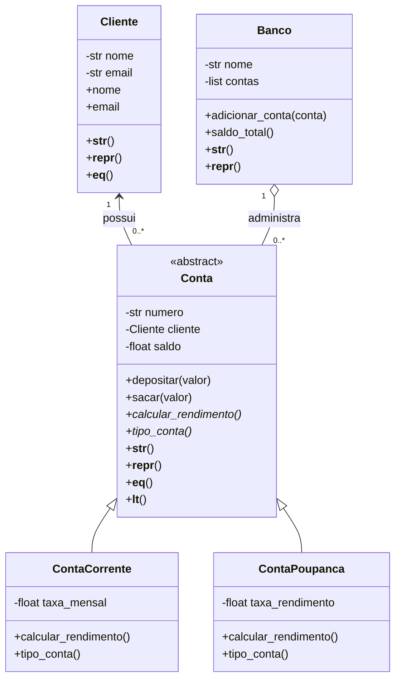

# Sistema Bancário Orientado a Objetos - Semana 06

Projeto desenvolvido como Desafio Sprint 6 da disciplina de Desenvolvimento em Python.

## Objetivo

O objetivo deste projeto é aplicar os principais conceitos de Programação Orientada a Objetos em Python:

- classes e objetos;
- encapsulamento;
- propriedades;
- classes abstratas;
- herança;
- composição;
- polimorfismo;
- métodos especiais;
- tratamento de exceções.

O sistema escolhido para demonstrar esses conceitos foi um sistema bancário simplificado.

## Estrutura do projeto

```text
python-poo-semana-06/
│
├── sistema_bancario.py
└── README.md
```

## Classes

O sistema possui cinco classes principais:

- `Cliente`;
- `Conta`;
- `ContaCorrente`;
- `ContaPoupanca`;
- `Banco`.

A classe `Conta` é abstrata e funciona como base para os diferentes tipos de conta.

## Diagrama de classes



## Classe abstrata

A classe `Conta` utiliza:

```python
from abc import ABC, abstractmethod
```

Sua declaração é:

```python
class Conta(ABC):
```

Ela determina comportamentos que todas as contas precisam implementar.

Por exemplo:

```python
@abstractmethod
def calcular_rendimento(self):
    pass
```

e:

```python
@abstractmethod
def tipo_conta(self):
    pass
```

Isso estabelece um contrato para as classes filhas.

## Herança

`ContaCorrente` e `ContaPoupanca` são tipos de `Conta`.

Portanto, a relação é de herança:

```text
ContaCorrente é uma Conta.
ContaPoupanca é uma Conta.
```

As classes filhas reaproveitam o construtor da classe mãe através de:

```python
super().__init__(
    numero,
    cliente,
    saldo
)
```

Dessa forma, atributos e validações comuns não precisam ser implementados novamente.

## Composição

Nem todas as relações devem utilizar herança.

O sistema utiliza composição em situações nas quais a relação é de “tem um”.

Por exemplo:

```text
Conta tem um Cliente.
Banco tem Contas.
```

Um banco não é uma conta, portanto não faria sentido utilizar herança entre essas classes.

Essa decisão segue o princípio de preferir composição quando não existe uma verdadeira relação “é um”.

## Encapsulamento

Os atributos internos utilizam nomes como:

```python
_nome
_email
_saldo
```

O acesso e a alteração são controlados utilizando `@property`.

Exemplo:

```python
@property
def saldo(self):
    return self._saldo
```

O setter impede que uma conta seja criada com saldo negativo:

```python
@saldo.setter
def saldo(self, valor):

    if valor < 0:
        raise ValueError(
            "O saldo não pode ser negativo."
        )

    self._saldo = float(valor)
```

Assim, o objeto não pode permanecer em um estado inválido.

## Validação de e-mail

A classe `Cliente` também protege o atributo `email`.

É utilizada uma expressão regular:

```python
r"^[\w\.-]+@[\w\.-]+\.\w+$"
```

Se o formato não for válido, o sistema gera:

```python
ValueError
```

Exemplo inválido:

```text
rafael-email.com
```

Exemplo válido:

```text
rafael@email.com
```

## Polimorfismo

As classes `ContaCorrente` e `ContaPoupanca` implementam o mesmo método:

```python
calcular_rendimento()
```

Porém, cada uma possui comportamento diferente.

Na conta corrente:

```python
def calcular_rendimento(self):
    return -self.taxa_mensal
```

Na poupança:

```python
def calcular_rendimento(self):

    return (
        self.saldo
        * self.taxa_rendimento
    )
```

Mesmo assim, os objetos podem ser tratados de maneira uniforme:

```python
for conta in contas:

    resultado = conta.calcular_rendimento()

    print(resultado)
```

A mesma chamada produz comportamentos diferentes dependendo do tipo real do objeto.

Esse é um exemplo de polimorfismo.

## Métodos especiais

O projeto implementa diferentes métodos especiais do Python.

### `__init__`

Responsável por construir e inicializar os objetos.

### `__str__`

Fornece uma representação amigável:

```python
print(conta)
```

### `__repr__`

Fornece uma representação mais técnica do objeto:

```python
repr(conta)
```

### `__eq__`

Permite comparar objetos.

As contas são consideradas iguais quando possuem o mesmo número:

```python
conta_1 == conta_2
```

### `__lt__`

Permite comparar contas pelo saldo.

Isso torna possível utilizar:

```python
sorted(contas)
```

e obter as contas em ordem crescente de saldo.

## Tratamento de exceções

O sistema utiliza blocos:

```python
try
```

e:

```python
except
```

para impedir que entradas inválidas encerrem o programa inesperadamente.

Foram testados casos como:

- e-mail inválido;
- saldo inicial negativo;
- saque superior ao saldo disponível.

## Exceção personalizada

Foi criada a exceção:

```python
class SaldoInsuficienteError(Exception):
    pass
```

Ela representa uma regra específica do sistema bancário.

É utilizada quando o usuário tenta retirar um valor superior ao saldo disponível.

Exemplo:

```python
if valor > self._saldo:

    raise SaldoInsuficienteError(
        "Saldo insuficiente para realizar o saque."
    )
```

## Instâncias utilizadas

A demonstração cria:

- 5 objetos `Cliente`;
- 3 objetos `ContaCorrente`;
- 3 objetos `ContaPoupanca`;
- 1 objeto `Banco`.

Isso resulta em mais de 10 instâncias para demonstrar o funcionamento do sistema.

## Exemplo de uso

Criando um cliente:

```python
cliente = Cliente(
    "Rafael Tajra",
    "rafael@email.com"
)
```

Criando uma conta:

```python
conta = ContaCorrente(
    "001",
    cliente,
    1500,
    20
)
```

Realizando depósito:

```python
conta.depositar(500)
```

Realizando saque:

```python
conta.sacar(200)
```

Obtendo o saldo:

```python
print(conta.saldo)
```

## Padrões de código

O projeto segue as convenções da PEP 8.

Classes utilizam `PascalCase`:

```text
Cliente
ContaCorrente
ContaPoupanca
SaldoInsuficienteError
```

Métodos e variáveis utilizam `snake_case`:

```text
calcular_rendimento
taxa_mensal
saldo_total
contas_ordenadas
```

As classes e principais métodos também possuem docstrings explicando seu propósito.

## Como executar

Abra o terminal dentro da pasta do projeto e execute:

```bash
python sistema_bancario.py
```

Dependendo da instalação do Python, utilize:

```bash
python3 sistema_bancario.py
```

O programa executará automaticamente a demonstração das classes, incluindo:

- criação de objetos;
- exibição das contas;
- depósitos;
- saques;
- polimorfismo;
- tratamento de exceções;
- comparações;
- ordenação de objetos.

## Autor

Rafael Tajra
